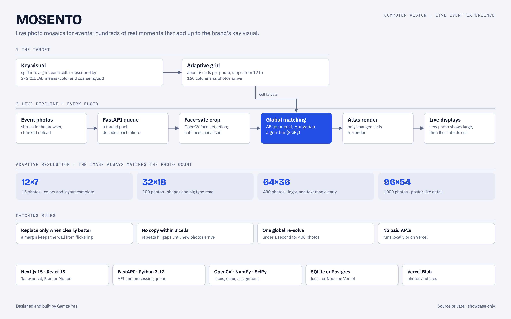
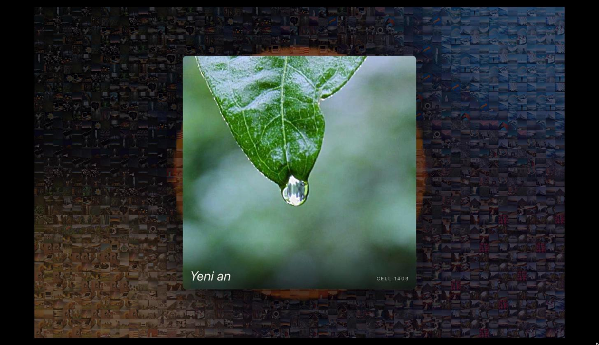
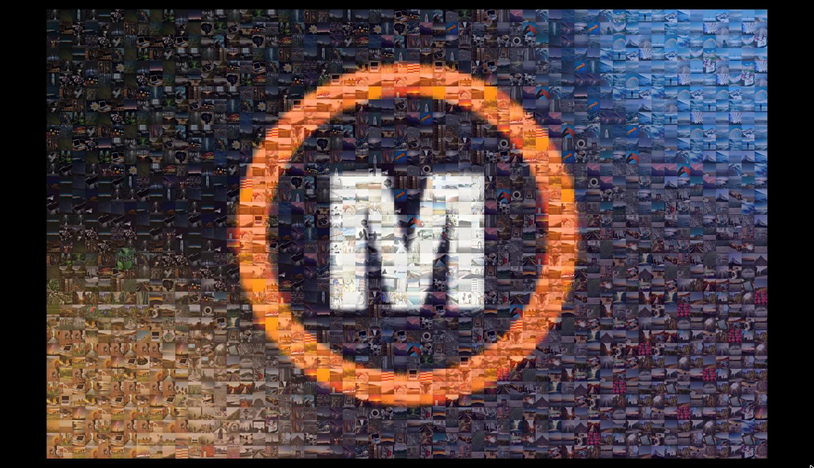
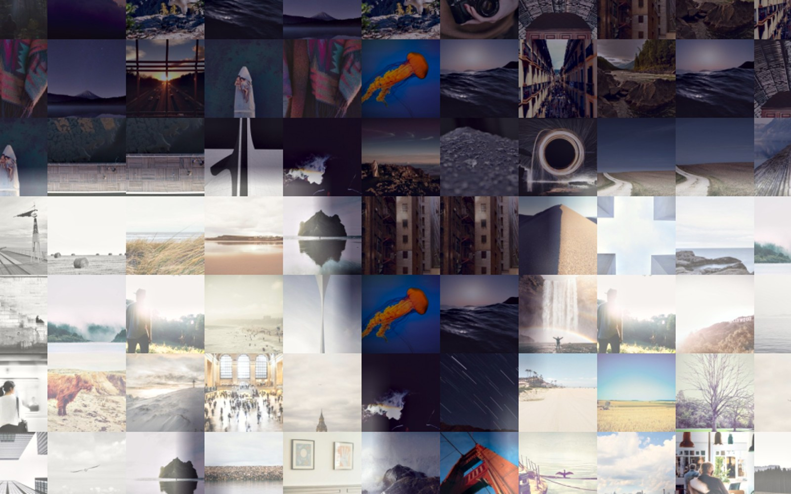
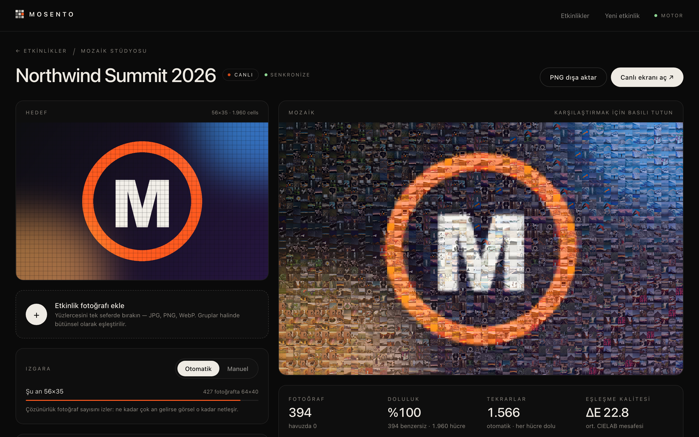
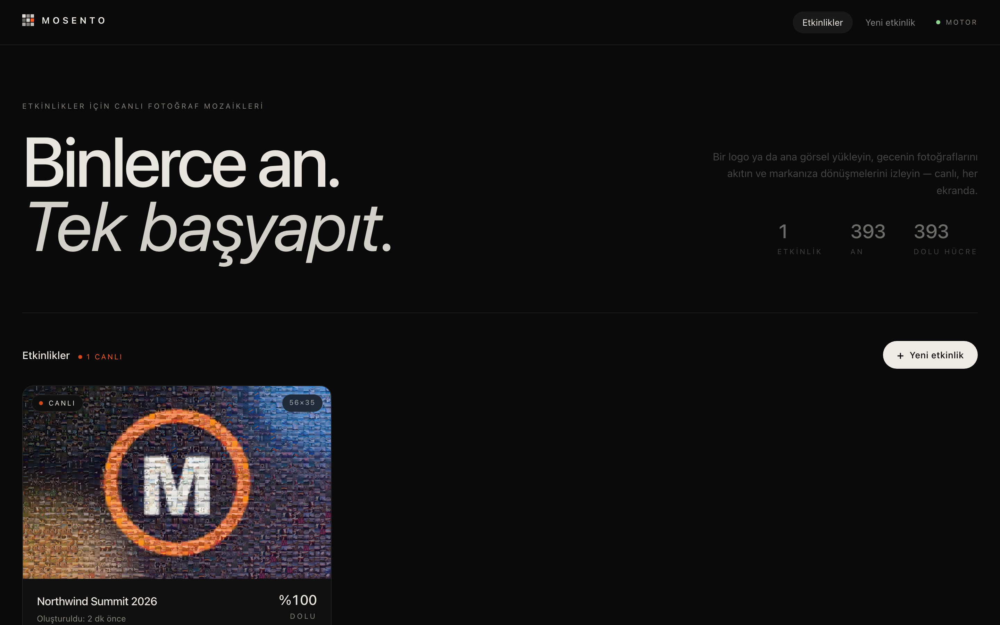

# MOSENTO

**Many moments. One masterpiece.** Live photo mosaics for events: guests' photos stream in, and each one finds the cell where its color and layout best match the brand's key visual. From a distance the wall reads as the logo. Up close it is hundreds of real moments.

<picture>
  <source media="(prefers-color-scheme: dark)" srcset="docs/architecture-dark.png">
  
</picture>

> The source code is private. This repository documents the architecture and the algorithms.

## What makes it work

- **Only real photo pixels.** The target image is never painted under the tiles. Every cell is described by the CIELAB means of a 2×2 sub-grid, so tiles match both color and coarse composition, and they line up with the edges of the logo.
- **Face-safe cropping.** OpenCV face detection (frontal and profile) chooses a crop that keeps as many faces whole as possible. A half-cut face costs more than a face left out. Without faces, the crop follows visual energy.
- **Global matching, not greedy.** Each batch of uploads is solved with the Hungarian algorithm (`scipy.optimize.linear_sum_assignment`) on a ΔE cost. A new photo can fill a free cell, replace a clearly worse occupant (only past a margin, so the wall never flickers), or wait in the pool.
- **Adaptive resolution.** The grid steps from 12 to 160 columns at about 6 cells per photo: 15 photos → 12×7, 400 → 64×36, 1000 → 96×54. When a level unlocks, every photo is re-placed in one global solve (under a second for 400 photos) and displays cross-fade to the sharper mosaic.
- **Blend mode for real event photos.** High-contrast shots from dark rooms read as mud from a distance. Blend shifts each tile's low-frequency color layout toward its cell and compresses internal contrast, while faces and detail always come from the photo.
- **Live displays.** A full-screen view for projectors and LED walls. Each new photo first appears large, then flies into its cell. An incrementally updated atlas keeps the preview cheap at thousands of cells. Exports go up to print resolution.

## In action

Demo event with 400 sample photos.

**Live display.** Each new photo first appears large ("New moment"), then flies into the cell it matches.

**Up close it is real photos.** A crop from the print export of the "M" in the logo.

**Mosaic Studio.** The target and the live mosaic side by side, with the auto grid level, coverage, repeats and average ΔE.

**Dashboard**

## Screens

Dashboard · Create Event (auto or manual grid, a "from a distance" preview) · Mosaic Studio (drag-and-drop upload, coverage and ΔE stats, re-optimise, export) · Live Display

## Stack

**Frontend:** Next.js 15 · React 19 · TypeScript · Tailwind CSS v4 · Framer Motion
**Backend:** Python 3.12 · FastAPI · OpenCV · Pillow · NumPy · SciPy · SQLite or Postgres (Neon) · Vercel Blob · pytest

It runs fully locally or on Vercel, with no paid APIs.

## My role

Product idea, mosaic engine, API, studio and live display UI, tests and deployment.
